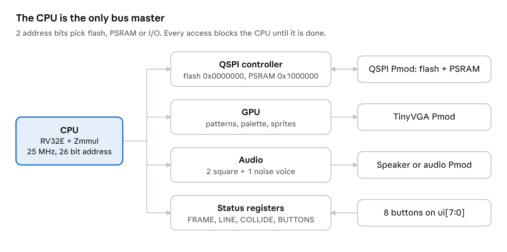
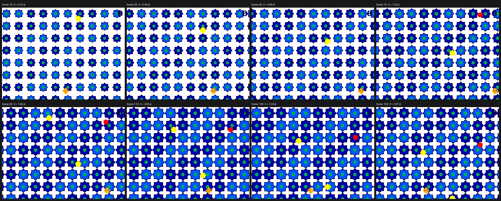
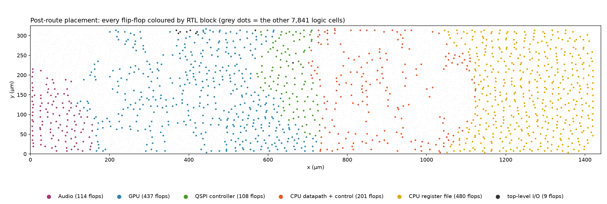
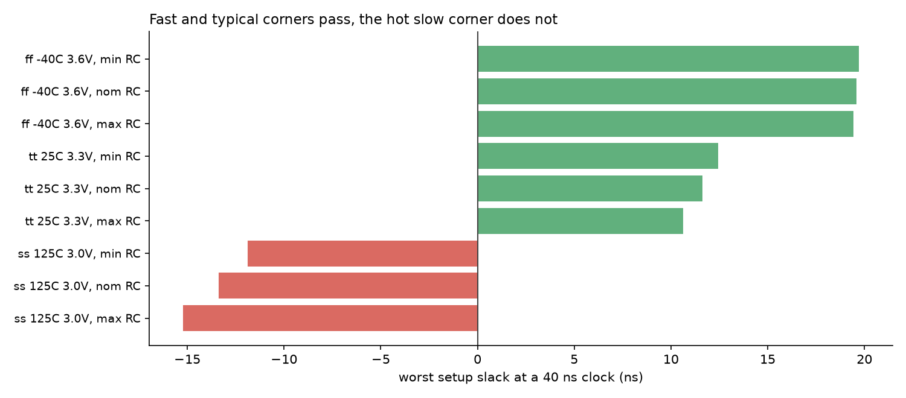

# Khatam-V

*a game console on one TT chip by sheheryar, hexa3*

writeup on my website: [sheheryar.xyz/khatam-v](https://sheheryar.xyz/khatam-v/)

## Intro

So i made Khatam-V, a game console on one Tiny Tapeout chip. It’s an RISC-V CPU, and it runs C from SPI flash. The gpu is used to draw islamic star patterns and sprites on VGA with absolutely no framebuffer. Khatam-v also has a small sound chip and run starfall. Which runs on both FPGA and simulations. The inspo for this project was my mosaic art that i used to do (and still sometimes do), along with some islamic art that ive been getting into lately. Khatam is the 8 pointed star in islamic geometry. And the screen background is made of them. I’ll likely make some more games since the design allows for that to happen. But i just wanted my first one (and the reason this chip exists) to be smth that’s part of my culture. Also it took me 2 weeks to go from VGA test stripes to a playable game :)

## Features

It has a CPU that is RV32E and it uses Zmmul and is multi cycle. It doesn’t have any pipeline and the normal clang compiles C. for the memory, its code is in SPI flash. The RAM is in SPI PSRAM and both of them are on the QSPI Pmod and it also run code solely and straight from the flash. For the graphics, its a 640x480 VGA 60hz. And every pixel is calcualted in 1 clock with 4 different star patterns and 4 shape sprites. There’s also 2 bitmap sprites and hardware collision detection. The sound comes from 2 square voice and one noise voice. With 1 PWM pin. The game, starfall is around 200 lines of C. and the project takes up 4x2 tiles on GF180. With 25 Mhz with it passing all the 12 TT prechecks

## To be implemented

I need to fix the timing at the slow corner. It has slow transistors and 125C. With low voltage. Its around 18 MHz instead of 25 and the list of fixes is in the ASIC section. I also need faster fetch, quad SPI or small instruction cache works. For now, starfall runs without problem but in the future when i code bigger games, they would face some pretty hefty problem. Also i need more games :)))

## CPU

So this is my CPU, in cpu.v. in RV32E there are 15 registers instead of 31 with each register being 32 flip flops. Theres no pipeline beecause the spi fetch is 65 to 130 clocks. And decode + run is around 3-4 clocks. Pipeline would speed up the wrong part. Also the state machine is small and makes timing on slow gf180. Theres 8 states. FETCH, RS1, RS2, EXEC, (MEM for loads/stores), (32x MUL + 3x FIX for multiplies), WB, back to FETCH. FETCH waits for instructions. RS1 and RS2 read source regs one at a time. RS2 also picks reg or immediate, and inverts for subtract.

EXEC is basically where all of the math happens, with just one adder and one shifter, and the result goes into lo, and then WB writes it into the register file one clock later, which i actually did on purpose so that only one flop drives the writes. the register file is like a third of all the flops on the whole chip, which is honestly more than the entire gpu lol, and thats also kind of why theres only one read port. the adder pretty much does everything, like add, sub, compares, branches and the load/store addresses, and sub is just a + ~b + 1. at first it was a ripple carry adder, but it took like half the clock at the slow corner, and yosys kept merging my carry select adder right back into ripple carry smh, so i made a Kogge-Stone adder that gets all the carries in five steps instead of thirty two.

Multiply is shift and add, because a real a * b multiplier would never ever fit. hi and lo are kind of one big sixty four bit shift register, and every clock it adds a into hi if the bottom bit is a one and then shifts, so after thirty two clocks you basically have the answer, and the three FIX states fix up the signed ones. the PC is only twenty six bits, theres no interrupts or traps, and on average its like a hundred clocks per instruction, with more than ninety percent of that just sitting in FETCH waiting.

## Memory over 4 wires

Literally all of the code and the ram go through four tiny wires, so qspi.v pretty much decides how fast the whole console is, obv no pressure. its just one bit spi in mode zero, with the flash and the PSRAM both using 0x03 for read and 0x02 for write, so its just one state machine, and the controller also swaps the bytes around because RISC-V is little endian. the thing that honestly saved everything is streaming. after a flash read CS just stays low, and if the next instruction is the one right after, it skips the command and the address and just keeps clocking, which makes fetches about twice as fast. If there is anything else, like a jump, goes to the CLOSE state, where CS goes high for a clock and then it starts a brand new command. in the end its a few hundred thousand instructions a second, which is really slow but totally fine for a game that mostly just waits for vblank anyway (which is going to change when i make some new games i promise).

## GPU

Theres no framebuffer, because 640x480 times six bits is way more memory than the whole chip even has, so every pixel’s color is calculated from the beam position, the frame counter and the registers in one clock. the screen is split into square cells, and each pixel gets folded into its distance from the middle of its cell, and for the left half i just flip the bits with ~, which saves a whole adder for each axis. an eight pointed star is really just a square plus the same square turned forty five degrees, so a pixel is in the star if ax and ay are both <= r, or if ax + ay <= 1.375 r. it should technically be 1.414, but 1.375 is just shifts and adds and honestly your eyes don’t care. octagons are the same thing but with AND instead of OR, and outlines are just inside at r but not inside at r - 3.

There are four patterns, star cross, octagons, interlaced and diamonds, and interlaced is honestly my favorite, because the second set of stars just uses the opposite fold, so i got two patterns for like a few inverters. theres also breathing, shimmer and scrolling to make it feel alive. for sprites theres four shape sprites and two eight by eight bitmap sprites that can scale up. collision was honestly really fun, the six sprite hits make a number called here, and if here AND (here - 1) isn’t zero then at least two sprites are overlapping. the flags just stay on until the cpu clears them, so the game only reads one register a frame.

 

*on the left is basically how everything connects, and on the right are real frames from the verilog sim (not an emulator), with the stars breathing, the lantern moving and the bombs falling*

## Sound

The sound is all in audio.v, and its three voices, about a hundred flops and just one pin. the square voices are twelve bit counters that count down from the period and flip, the noise is a fifteen bit LFSR with the NES taps, and everything gets mixed with four bit volumes into PWM at a few hundred kHz, with an RC filter on the pin. funny thing is the counter makes the notes a little flat and NOTE() makes them a little sharp, so they pretty much cancel out. total lucky accident lol, but im taking credit for it anyway.

## Memory map and pins

Flash is at zero and thats where the program starts, PSRAM is at 0x1000000 for the variables and the stack, and I/O is at 0x2000000. the I/O has registers for the pattern, the star size, scrolling, the five palette colors, the six sprites, the frame and line counters, collision, the buttons and the three voices. for the pins, ui[7:0] are the buttons, uo[7:0] go to the TinyVGA Pmod, and uio has the flash CS, MOSI, MISO, SCK, IO2 and IO3 held high, the PSRAM CS and the audio PWM.

## Software and Starfall

The game is literally just one C file, compiled with clang and lld and written to flash at zero, with no OS or anything. crt0.S sets up the stack, copies the data into PSRAM, clears .bss and calls main, and khatam.h has all the register names and helpers like shape() and wait_vblank(). in starfall you catch falling stars with a lantern and dodge the red octagons, and like one in four falling things is a bomb. catches and hits come straight from the hardware collision flags, every ten stars you level up with a new pattern and faster stars, and you get three lives, plus a bass line and beeps and stuff.

## ASIC Synthesis

The CI uses LibreLane on GF180, and DRC, LVS, antenna, hold and all twelve prechecks pass, but setup only passes at typical and fast and fails at slow and hot. its four by two tiles and around seventy percent full, with like more than half a meter of wire, which is honestly crazy. i plotted where every flop got placed, and even though i never told the tools to, they kind of kept every block together on their own. at room temp it makes twenty five MHz easily, maybe even thirty five, but at the slow corner its more like eighteen, mostly because the whole pixel calculation happens in one clock. the fixes are adding an extra clock in the pixel pipeline, making reset synchronous, fixing max slew and splitting up some of the cpu paths.

 

*on the left is where every flop got placed, colored by block, and on the right is the setup slack for every corner, where slow is like twelve to fifteen ns short*

## Design challenges / bugs

Honestly every module by itself was pretty easy, with all the hard bugs being between modules. the first instruction was a whole saga. Because first of all, the byte was backwards, and then everything after the first couple bytes was garbage, and the real fix was reading MISO right before SCK falls instead of when it rises like what i was doing before. and then surprise surprise, the bytes were in the wrong order too. then jumps broke literally everything, because CS was still low from streaming, and the CLOSE state fixed that. i also found out that ninety six percent of every frame is spent in wait_vblank(), so theres like twenty times more speed than i need, and clang never even calls divide, because % turns into a multiply by a magic number, so my multiplier made modulo fast without me even planning it. and then there was a whole pile of small ones, like bltu and bgeu being swapped, the noise being silent because the LFSR started at zero, bitmaps drawn backwards, and the very first picture rolling because the line was eight hundred one clocks long.
